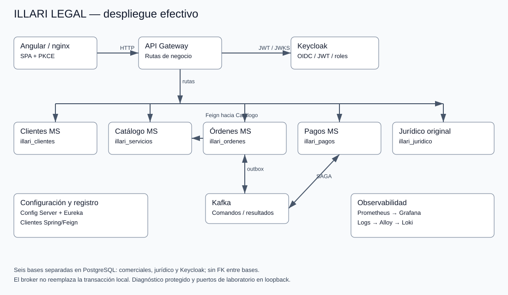
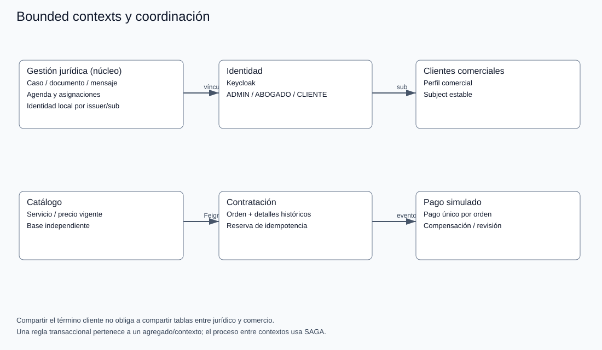

# Arquitectura efectiva y bounded contexts

El punto de entrada de negocio es Gateway. Config Server y Eureka son infraestructura de configuración/descubrimiento; no coordinan pagos. Órdenes consulta Catálogo con Feign y resuelve su nombre lógico mediante Eureka. Kafka transporta orden.creada, solicitud de cancelación y resultados de Pagos. Los outbox son durables y los inbox evitan repetir efectos.

| Contexto | Agregado/responsabilidad | Almacenamiento |
|---|---|---|
| Gestión jurídica | Caso, asignación, documentos, mensajes y agenda | illari_juridico; módulos del backend original |
| Clientes comerciales | Perfil comercial vinculado al sub | illari_clientes |
| Servicios legales | Catálogo y precio vigente | illari_servicios |
| Contratación | Orden y sus detalles históricos; intención de compra | illari_ordenes |
| Pago simulado | Un pago por orden, estado/revisión y compensación | illari_pagos |
| Identidad | Cuentas/roles y sesión OIDC | Keycloak + illari_keycloak |

El cliente jurídico local y el perfil comercial no comparten una tabla por llamarse «cliente». Se vinculan a la identidad del issuer/sub sin cruzar FKs. El núcleo jurídico no se convirtió artificialmente en un microservicio por entidad. Los límites transaccionales están dentro de cada base/contexto; la coordinación entre ellos es eventual.

La guía de dominio del otro curso orienta a separar responsabilidades por reglas y lenguaje, no solo por tablas. No reemplaza la rúbrica de Distribuidas ni acredita por sí sola diagramas/defensa de otro curso.
