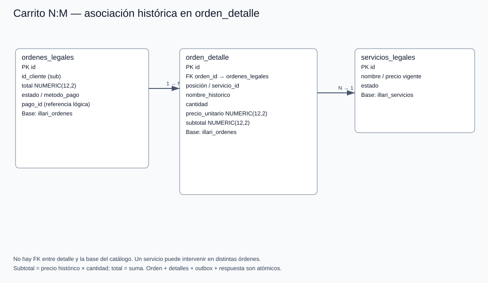

# Modelo relacional del carrito N:M

Una orden puede incluir varios servicios; un servicio puede aparecer en varias órdenes. La entidad asociativa `orden_detalle` contiene orden_id, posición, servicio_id, nombre_historico, cantidad, precio_unitario y subtotal. No se representa mediante varios pagos de la misma solicitud.

| Relación | Persistencia física |
|---|---|
| ordenes_legales1→Norden_detalle | FK local orden_id en illari_ordenes |
| Servicio1→N referencias en detalles | Referencia lógica por servicio_id; sin FK a illari_servicios |
| Orden→Pago | Identificador lógico y unicidad por id_orden en illari_pagos; sin FK entre bases |

Precio y nombre se guardan históricamente. NUMERIC(12,2)/BigDecimal evita aritmética binaria para importes. Subtotal=precio×cantidad; suma de subtotales=total positivo. El catálogo debe estar activo y resolver el mismo ID pedido. Orden, detalles, respuesta idempotente y outbox se confirman juntos o hacen rollback.

Migración05 conserva detalles_json y hace backfill transaccional después de04; valida históricos antes de redondear/insertar y aborta ante inconsistencia.06 añade inbox/outbox/DLT y auditoría. Nunca ejecutar sobre una base anterior sin inspección, respaldo y autorización. El histórico de prueba9000 mantuvo JSON,2 detalles y120.00.
